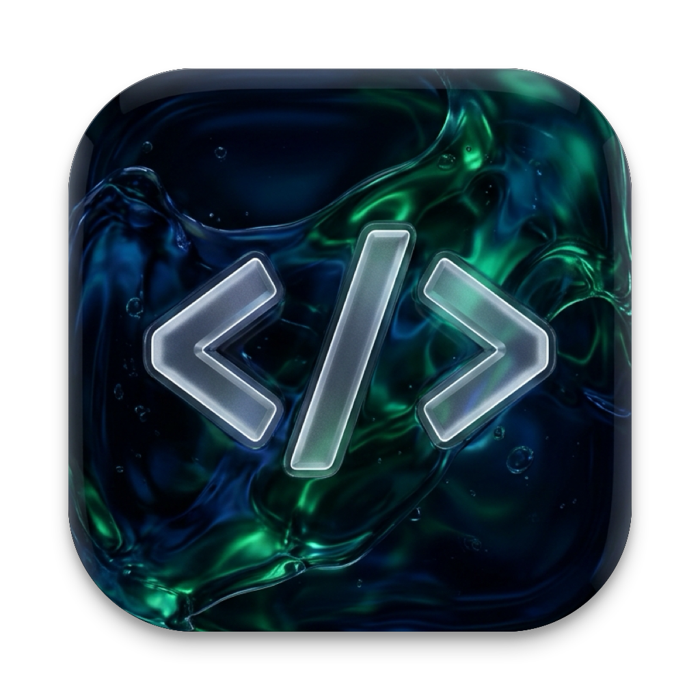
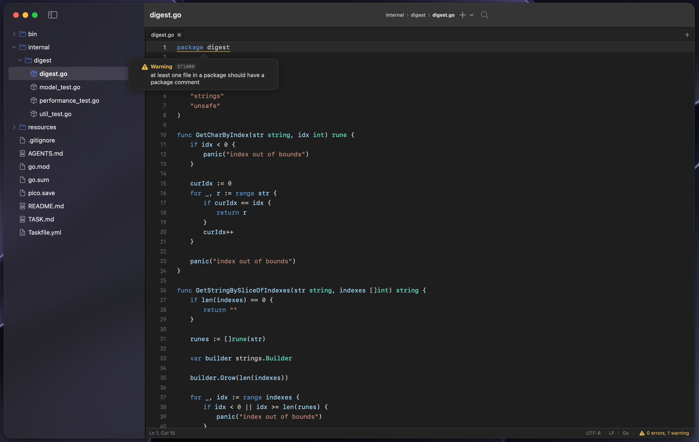

<div align="center">



# Code Editor

### Lightweight, Native macOS Code Editor Built with Swift & SwiftUI

<a href="https://github.com/Yan123-tech/code-editor">
  
</a>

<p align="center">
  <a href="https://github.com/Yan123-tech/code-editor/actions/workflows/ci.yml">
    
  </a>
  <a href="https://swift.org">
    
  </a>
  <a href="https://apple.com/macos">
    
  </a>
  <a href="https://apple.com">
    
  </a>
  <a href="https://github.com/Yan123-tech/code-editor/actions">
    
  </a>
  <a href="https://github.com/Yan123-tech/code-editor/actions">
    
  </a>
  <a href="https://gemini.google.com">
    
  </a>
  <a href="LICENSE">
    
  </a>
</p>

<p align="center">
  <a href="https://skillicons.dev">
    
  </a>
</p>

*A clean, blisteringly fast developer environment powered by native Apple frameworks, Language Server Protocol (LSP), POSIX PTY terminal emulation, and multi-provider AI completions.*

<br/>

<p align="center">
  
</p>

</div>

---

##  Highlights

<table>
  <tr>
    <td width="50%">
      <h3> Native POSIX PTY Terminal</h3>
      Genuine pseudo-terminal (<code>posix_openpt</code>) running your default <code>$SHELL</code>. Supports 24-bit RGB truecolor, inline carriage-return overwrites (<code>\r</code>), window resizing signals (<code>TIOCSWINSZ</code>), process-group interrupts, and interactive TUIs (<code>vim</code>, <code>top</code>, <code>git log</code>).
    </td>
    <td width="50%">
      <h3> Language Server Protocol (LSP)</h3>
      First-class LSP support for <b>Swift</b> (<code>sourcekit-lsp</code>) and <b>Go</b> (<code>gopls</code>) over a robust, non-blocking <code>DispatchSourceRead</code> JSON-RPC transport. Features fuzzy autocomplete, parameter hints, and automatic <code>gofmt</code> formatting on save.
    </td>
  </tr>
  <tr>
    <td width="50%">
      <h3> Live Diagnostics & Problems</h3>
      Real-time compiler diagnostic markers in the gutter, squiggly underlines beneath issue ranges, summary error/warning badges in the status bar, jump hotkeys (<code>⌘'</code> / <code>⇧⌘'</code>), and an interactive Problems popover.
    </td>
    <td width="50%">
      <h3> AI Code Assistance</h3>
      Configurable OpenAI-compatible backend supporting <b>OpenAI</b>, <b>Ollama</b>, <b>LM Studio</b>, and <b>OpenRouter</b>. Features debounced query dispatch, multi-line documentation previews, and markdown artifact cleanup.
    </td>
  </tr>
  <tr>
    <td width="50%">
      <h3> Liquid Glass macOS HIG Design</h3>
      Crafted exclusively for macOS using SF Pro typography, a strict 4pt grid system, Dark / Light / High-Contrast themes, a native Settings window (<code>⌘,</code>), and a bespoke Liquid Glass app icon.
    </td>
    <td width="50%">
      <h3> Battle-Tested Reliability</h3>
      Hardened against edge cases: swizzled <code>NSBezierPath.safeBounds</code> preventing AppKit empty path crashes, <code>SIGPIPE</code> immunity, file modification guards, and <b>156 automated test suites</b>.
    </td>
  </tr>
</table>

---

##  What Works Today

- **File Explorer**: Recursive directory tree with asynchronous lazy loading, file/folder creation, inline renaming, deletion, and Finder integration. System dotfiles are cleanly hidden.
- **Source Editor**: Full `NSTextView`-backed editor (via [CodeEditSourceEditor](https://github.com/CodeEditApp/CodeEditSourceEditor)) with Tree-sitter syntax highlighting, line numbers, bracket-pair highlighting, indentation-on-type, word wrap, and unified undo stack.
- **34 Supported Languages**: Swift, Go, JavaScript, TypeScript, JSX, TSX, Python, Rust, C, C++, C#, Java, Ruby, HTML, CSS, JSON, Shell, Markdown, and all `TreeSitterLanguage` grammars exposed by `CodeEditLanguages`.
- **Tabs & Buffers**: Multiple open documents, dirty state indicators, safe close alerts, and smart file-change detection on disk (Reload vs. Overwrite vs. Cancel).
- **Find & Replace**: Built-in find and replace panel (`⌘F`) with match navigation.
- **Quick Open (`⌘P`)**: Instant fuzzy file search across the entire project workspace with live matched character highlighting.
- **Integrated PTY (`^```)**: Toggleable bottom drawer terminal. Drag the divider to smoothly resize with debounced layout updates.
- **LSP Diagnostics**: Live error and warning gutter indicators, squiggly underlines, status bar counts, and jump shortcuts (`⌘'` / `⇧⌘'`).
- **AI Autocompletions**: Toggle between LSP and AI completion modes directly in Settings or via hotkeys.
- **Session Restoration**: Seamlessly restores your open workspace and active tabs on next launch.

---

##  Keyboard Shortcuts

| Shortcut | Command | Shortcut | Command |
|:---:|:---|:---:|:---|
| `⌘N` | New file | `^``` | Toggle integrated terminal |
| `⌘O` | Open project folder | `⌘'` | Jump to next diagnostic problem |
| `⇧⌘O` | Open specific files | `⇧⌘'` | Jump to previous diagnostic problem |
| `⌘F` | Find in document | `⇧⌘L` | Toggle Dark / Light theme |
| `⌘P` | Quick Open fuzzy search | `⌘,` | Open Preferences / Settings |
| `⌘S` | Save document | `⌘B` | Toggle project sidebar |
| `⌥⌘S` | Save all modified documents | `⌘W` | Close current tab |

---

##  Getting Started

### Prerequisites
- **macOS 14.0 (Sonoma)** or later
- **Xcode 16** with the **Swift 6.4+** toolchain

### Build & Run from Source

```bash
# Clone the repository
git clone https://github.com/Yan123-tech/code-editor.git
cd code-editor

# Build debug binary
swift build

# Run the application
swift run CodeEditorApp
```

### Run Test Suite

```bash
swift test
```

### Packaging the `.app` Bundle

To package a standalone, double-clickable `Code Editor.app` with icons and embedded language bundles:

```bash
# Build release bundle into build/Code Editor.app
./Scripts/build-app.sh

# Or build debug bundle and launch immediately
./Scripts/build-app.sh --debug --open
```

| Flag | Description |
|:---|:---|
| `--debug` | Compiles the debug build configuration instead of release |
| `--open` | Automatically launches the application once packaged |
| `--install` | Copies the compiled `.app` bundle into `/Applications` |

### Code Formatting & Linting

```bash
# Format code in-place
swift-format format --in-place --recursive --configuration .swift-format Sources Tests

# Lint strictly
swift-format lint --recursive --strict --configuration .swift-format Sources Tests
```

---

##  Continuous Integration

Every Pull Request and commit to `main` is validated through automated GitHub Actions workflows:

```
┌────────────────────────────────────────────────────────┐
│                   GitHub Actions CI                    │
├─────────────────────┬──────────────────┬───────────────┤
│ Format              │ Syntax           │ Build & Test  │
│ macos-latest        │ macos-latest     │ Apple Silicon │
│ (swift-format lint) │ (swiftc -parse)  │ (156 tests)   │
└─────────────────────┴──────────────────┴───────────────┘
```

- **Hosted Runners (`macos-latest`)**: Fast formatting and syntax checks.
- **Dedicated Self-Hosted Runner (`yan-macbook-runner`)**: Apple Silicon runner executing `swift build`, `swift test` (156 unit & end-to-end tests), and `./Scripts/build-app.sh --debug` bundle layout and codesigning.

---

##  Project Architecture

```
Code Editor/
├── Sources/
│   ├── CodeEditorCore/       # Documents, selection, file system, quick open, metrics
│   ├── CodeEditorThemes/     # Liquid Glass palettes, chrome tokens, typography
│   ├── CodeEditorTerminal/   # POSIX PTY, ANSI parser, process signals, window resize
│   ├── CodeEditorLSP/        # DispatchSourceRead transport, LSPClient, OpenAIClient
│   ├── CodeEditorUI/         # SwiftUI views, sidebar, tabs, terminal drawer, settings
│   └── CodeEditorApp/        # Application entry point, window chrome, menu bar
├── Tests/                    # 156 comprehensive unit and integration tests
├── Resources/                # 1024x1024 Liquid Glass AppIcon.png & vector icons
└── Scripts/                  # App bundle packaging and icon compilation
```

<details>
<summary><b> Architectural Documentation</b></summary>

- [docs/IDEA.md](docs/IDEA.md) — Product philosophy and non-goals
- [docs/ARCHITECTURE.md](docs/ARCHITECTURE.md) — Module boundaries and data flow
- [docs/MEMORY.md](docs/MEMORY.md) — Critical architectural constraints & system invariants
- [docs/CURRENT_STATE.md](docs/CURRENT_STATE.md) — Active roadmap status and test coverage
- [docs/PROCESS.md](docs/PROCESS.md) — PR lifecycle, local gates, and definition of done
- [docs/BRANCHING.md](docs/BRANCHING.md) — Git workflow and branch naming conventions
- [docs/COMMITTING.md](docs/COMMITTING.md) — Conventional Commits guidelines

</details>

---

##  Roadmap

- [x] **Completion Popup** — Fuzzy-filtered LSP completion menu ([#1](https://github.com/Yan123-tech/code-editor/issues/1))
- [x] **Diagnostics & Problems Popover** — Live compiler issues and jump hotkeys ([#2](https://github.com/Yan123-tech/code-editor/issues/2), [#10](https://github.com/Yan123-tech/code-editor/pull/10))
- [x] **External Change Detection** — Safe reload prompts when disk files change ([#6](https://github.com/Yan123-tech/code-editor/issues/6))
- [x] **POSIX PTY Terminal** — Embedded terminal with truecolor & resize support ([#5](https://github.com/Yan123-tech/code-editor/issues/5), [#7](https://github.com/Yan123-tech/code-editor/pull/7))
- [x] **Native Settings Panel** — Preferences window with modular tabs ([#4](https://github.com/Yan123-tech/code-editor/issues/4), [#8](https://github.com/Yan123-tech/code-editor/pull/8))
- [x] **Go Language Support** — `gopls` integration and `gofmt` on save ([#17](https://github.com/Yan123-tech/code-editor/issues/17), [#18](https://github.com/Yan123-tech/code-editor/pull/18))
- [x] **AI Autocompletions** — Multi-provider AI streaming backend ([#21](https://github.com/Yan123-tech/code-editor/issues/21), [#22](https://github.com/Yan123-tech/code-editor/pull/22))
- [x] **Liquid Glass App Icon** — macOS HIG app icon redesign ([#30](https://github.com/Yan123-tech/code-editor/issues/30), [#31](https://github.com/Yan123-tech/code-editor/pull/31))
- [ ] **Find in Project** — Global workspace search & replace (`⇧⌘F`) ([#27](https://github.com/Yan123-tech/code-editor/issues/27))
- [ ] **Inline Ghost-Text AI** — Multi-token inline suggestions accepted with Tab ([#28](https://github.com/Yan123-tech/code-editor/issues/28))
- [ ] **Git Gutter Diff Markers** — Gutter line additions/deletions and branch status ([#29](https://github.com/Yan123-tech/code-editor/issues/29))
- [ ] **Hover & Go-to-Definition** — Quick docs and jump-to-source ([#3](https://github.com/Yan123-tech/code-editor/issues/3))

---

##  Contributing

Contributions are welcome! Please check our [Contributing Guidelines](docs/PROCESS.md) and [Branching Strategy](docs/BRANCHING.md) before submitting a Pull Request.

1. Fork & branch off `main` (`git checkout -b feature/your-feature`)
2. Format code (`swift-format format --in-place --recursive Sources Tests`)
3. Run tests (`swift test`)
4. Commit following [Conventional Commits](https://www.conventionalcommits.org/)
5. Open a Pull Request and verify CI status

---

##  License

This project is licensed under the **MIT License** — see the [LICENSE](LICENSE) file for details.

---

##  Built with AI Agents

> [!NOTE]
> This project is built and evolved collaboratively with **autonomous AI agents** powered by **Google DeepMind's Gemini models**.
>
> From native macOS Swift & SwiftUI architecture, POSIX PTY pseudo-terminal subsystems, and Language Server Protocol implementations to self-hosted Apple Silicon CI/CD pipelines — every architectural decision and implementation detail is paired with automated AI coding assistants, prioritizing transparency and best engineering practices.

